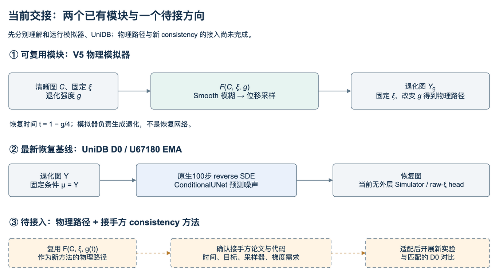

# 当前方法与代码

**现在可以接着使用的是两个独立模块：物理模拟器生成湍流图，UniDB 基线从湍流图恢复清晰图。会议提出的“物理路径＋consistency”还没有实现。** 本章解释各模块如何工作、怎样找到代码，以及连接它们之前需要明确的接口。最新权重与效果见[项目现状](01_项目现状.md)，实际命令见[服务器环境与运行](04_服务器环境与运行.md)。

图中的已有模块可以分别运行；橙色虚线表示待开发部分，不表示已经完成了联合训练或新方法验证。

## 1. 物理模拟器：从清晰图生成退化图

模拟器描述大气湍流造成的空间变化模糊与几何扭曲：

**<i>Y</i>g = <i>F</i>(<i>C</i>, ξ, <i>g</i>)**

|对象|含义与当前约定|
|---|---|
|输入 <i>C</i>|清晰 RGB 图，当前配置为 `[B,3,256,256]` 的 FP32 张量|
|输入 ξ|固定的一次湍流随机实现，由 ξz 与 ξtilt 两块原始高斯随机源组成|
|输入 <i>g</i>|退化强度，范围为 0 到 4；越接近 0 越接近清晰端点|
|输出 <i>Y</i>g|先经过空间变化模糊和 Smooth，再按位移场采样得到的 RGB 退化图|
|辅助输出|仅模糊图、PSF 基系数、像素位移，以及归一化采样网格；这些对象有不同单位和用途|

这个模块使用固定的物理参数、相关性矩阵、频域滤波器和冻结的 P2S 映射。**当前不训练模拟器本身，也没有恢复损失。** 它在恢复研究中的用途是生成训练配对或物理中间态；需要时，梯度可以通过模拟器传向输入图像与原始随机源。已验证的范围和局限见[模拟器原理](02_模拟器原理.md)，不能将一次一阶反向成功扩展为所有时间导数、高阶梯度都可用。

固定同一张 <i>C</i> 和同一 ξ，改变 <i>g</i>，才能追踪同一次湍流实现的强度路径。现有 V5 物理恢复时间定义为：

**<i>t</i> = 1 − <i>g</i>/4，因此 <i>X</i>t = <i>F</i>(<i>C</i>, ξ, 4(1 − <i>t</i>))。**

沿 <i>t</i> 从 0 到 1，路径从强湍流端走向清晰端。中间图随模糊核和位移共同变化，并非把固定终点图 <i>Y</i>4 与 <i>C</i> 简单做线性插值。这里是在定义一条可生成的物理路径，还没有定义新的 consistency 训练目标。

## 2. UniDB 恢复基线：以退化图为条件的扩散恢复

当前恢复基线使用 UniDB 原生条件 UNet，在 RGB 像素空间工作。默认交接示例加载原路线 U67180 的 EMA 权重；其初始化来自官方 `gamma_1e7.pth`。权重身份与结果以[项目现状](01_项目现状.md)为准。

**训练时**有清晰图 <i>C</i> 和对应退化图 <i>Y</i>，过程是：

1. UniDB 根据这一对图随机抽取内部时间 τ，并生成桥状态 <i>x</i>τ。
2. 条件 UNet 使用当前状态、退化条件 <i>Y</i> 和时间 τ 预测噪声，再按原生公式换算为 score。
3. 用预测 score 得到反向一步的预测均值，与利用清晰图 <i>C</i> 计算的最优反向一步目标做 L1 匹配。

可将目标概括为：

**<i>L</i>native = MAE(<i>m</i>θ(<i>x</i>τ, <i>Y</i>, τ), <i>m</i>⋆(<i>x</i>τ, <i>C</i>, τ))。**

这里 <i>m</i>θ 是预测反向一步均值，<i>m</i>⋆ 是用清晰图计算的目标。对应实现为 `NativeObjective.forward()` 中的 `reverse_sde_step_mean`、`reverse_optimum_step` 和 `MatchingLoss(loss_type='l1')`。该损失监督的是随机时间的一步均值，不是将完整 100 步恢复结果直接与清晰图计算 MAE。

**推理时**只需要退化图 <i>Y</i> 作为图像输入：先执行 `set_mu(Y)` 固定条件，再从 <i>Y</i> 调用 `reverse_sde(Y)`，经原生 100 步随机反向过程得到恢复图 Ĉ。清晰图仅用于评价；100 步内部没有调用物理模拟器，也没有 VQ 编解码往返。示例的 `forward` 只检查一次网络输出，只有 `restore` 才执行完整恢复。

这里的 **D0 表示没有外层物理递归的恢复基线**，并不表示网络只调用一次。当前 UniDB 没有预测 raw ξ 的输出头，也没有实现会议提出的 consistency loss。原路线保持上述原生训练目标；另一条实验路线同时改变了目标、初始化与优化设置，不能把它当成单因素消融，其记录统一保存在[最终实验归档](../03_归档资料/handoff/evidence/unidb_dual_20261104_until00/report/FINAL_REPORT_ZH.md)。

## 3. 两种时间分别控制什么

|变量|控制的过程|当前含义|
|---|---|---|
|物理恢复时间 <i>t</i>|模拟器构造的物理路径|<i>t</i> = 1 − <i>g</i>/4；0 对应强度 4，1 对应清晰端|
|UniDB 内部时间 τ|恢复基线的随机桥与反向采样|使用原生 100 步过程；训练随机抽取内部时间，推理执行反向采样|

两者没有现成的一一换算关系。接入新方法时，不能直接把 UniDB 的第几步当成某个物理强度，也不能把“物理路径＋100 步采样”直接称为已经实现的 consistency 方法。

## 4. 下一步：将物理路径接入接手方的一致性方法

会议方向是用物理模型控制的路径替换原一致性方法中的线性插值路径。**当前已有的是模拟器、恢复基线和运行证据；原一致性实现、目标推导及新采样器尚待接手方提供和适配。** “CGDB”等名称需与团队实际论文和代码版本核对，公开同名论文不能直接代替这一确认。

|要确定的接口|现在能提供什么|接入前还需明确什么|
|---|---|---|
|物理状态与时间|<i>F</i>(<i>C</i>, ξ, <i>g</i>) 及 <i>t</i> = 1 − <i>g</i>/4|新方法的时间方向、端点、强度变换是否采用同一定义|
|同一条训练路径|清晰图、退化配对、原始随机源的复现信息|哪些时间共享 ξ，怎样生成训练状态，哪些量在推理时可获得|
|网络输入与输出|UniDB 使用当前状态、退化条件和内部时间，输出噪声预测|新方法预测 clean、noise、velocity 还是 raw ξ；是否继续使用 UniDB，以及所需结构改动|
|训练目标|可查验的 UniDB 原生一步均值匹配实现|接手方原 consistency loss、teacher/EMA、停止梯度的定义；换路径后原推导是否仍成立|
|梯度与端点|清晰图与 raw ξ 的有限范围一阶反向验证|是否需要 ∂<i>F</i>/∂<i>t</i>、JVP 或高阶梯度，如何处理 <i>g</i> = 0 附近的行为|
|推理与比较|已验证的 UniDB 100 步恢复入口及正式评价记录|新采样器、网络调用次数、随机性，以及与 D0 匹配的数据、初始化和预算|

接手后的顺序是：先分别跑通两个已有模块；再记录一致性代码版本并确认上述接口；在新工作目录检查少量固定样本的路径、所需导数及保存恢复；最后开展约定预算的训练与匹配对照。这是后续实施顺序，本次没有执行新的联合方法训练。

历史 V5 的 D0/A/B 递归方案及结果统一见[历史方法归档](../03_归档资料/docs/meeting_20261104/METHODS_HISTORY.md)。

## 5. 看代码从这几处开始

下列文件是从归档原样复制出来的当前阅读入口，源码内容未改写。**运行示例仍调用服务器 `/data2/yanglin` 下的现有工程与资产；这些阅读副本不是包含全部依赖的数据与模型安装包。**

|要理解的内容|核心代码|先找什么|
|---|---|---|
|模拟器完整流程|[物理模拟器 `simulator_v5.py`](../02_代码与运行/01_物理模拟器/simulator_v5.py)|`effective_state()` 生成有效物理场；`render_prepared()` 完成模糊、Smooth 与采样；`build_simulator()` 绑定固定物理资产|
|UniDB 模型、训练目标与采样配置|[恢复基线 `core.py`](../02_代码与运行/02_图像恢复基线/core.py)|`initialize()` 严格加载官方初始化；`NativeObjective.forward()` 实现原生目标；`process()` 配置 100 步过程|
|训练配对怎么进入模型|[恢复基线 `data.py`](../02_代码与运行/02_图像恢复基线/data.py)|`load_pool()` 核对数据清单；`Positions.__getitem__()` 读取配对与强度|
|最后一轮实验如何训练和评价|[训练 `training_worker.py`](../02_代码与运行/03_训练与评价/training_worker.py)、[评价 `validation.py`](../02_代码与运行/03_训练与评价/validation.py)|用于查明既有运行过程；旧目录、截止与来源校验仍在，不能直接当新训练启动器|
|接手时实际怎样调用|[运行示例](../02_代码与运行/运行示例.py)|`inspect` 检查前置资产；`simulator` 跑物理模块；`unidb --action restore` 跑恢复模块；完整参数见[运行指南](04_服务器环境与运行.md)|

官方 UniDB 的完整 vendor 未随源码副本分发；来源与固定版本见[论文与素材](05_论文与素材.md)，服务器依赖位置见[运行指南](04_服务器环境与运行.md)。需要查更多历史函数时再使用[归档代码索引](../03_归档资料/docs/meeting_20261104/CODE_MAP.md)。
