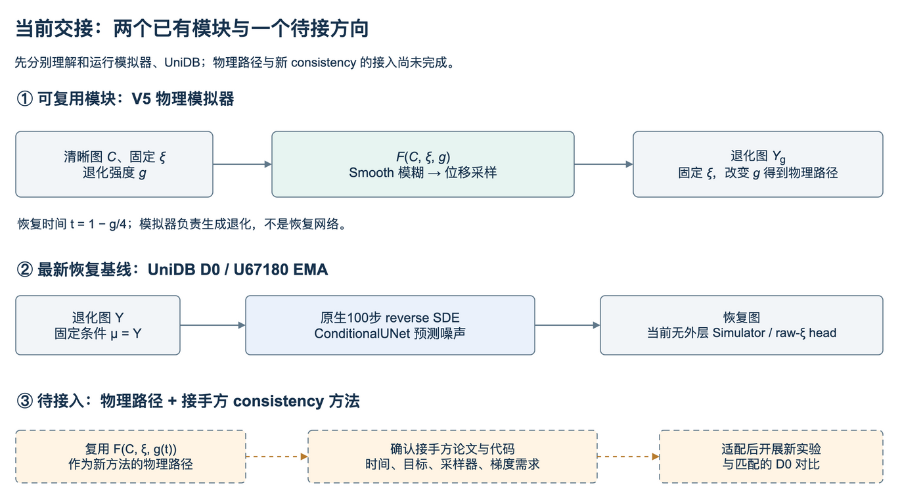

# 当前方法与下一步接入

## 1. 当前交接的是两个已有模块

**可复用的V5模拟器**负责退化生成：清晰图C、原始随机源ξ与强度g输入F，输出一条物理退化路径。**最新UniDB D0**负责恢复：退化图Y作为条件，通过原生100步reverse SDE得到恢复图。两个模块都有独立运行入口，当前尚未连成会议提出的新consistency方法。

V5的物理恢复时间t=1−g/4，与UniDB内部τ=1…100不是同一变量。接手时先分别跑通二者，再根据接手方真实consistency代码定义接口。

历史只需先记住一条结论：V5 Concertormer B在匹配Val1000上比独立D0高约0.293dB，但第四步仍弱于自身第一步；这说明可以复用物理模块，尚不能声称多步恢复已经稳定有效。D0/A/B目标与完整展开公式放在[历史方法附录](METHODS_HISTORY.md)。

## 2. 当前UniDB：当前有条件扩散，但没有外层物理递归

官方DIV2K SR `gamma_1e7.pth`初始化，固定commit见[论文/官方源](PAPERS.md)。项目`core.py`的`NativeObjective.forward`执行：

1. 给clean和degraded生成随机τ及桥状态。
2. 条件UNet以当前状态、Y、τ预测noise；通过原生公式转score。
3. 比较预测反向一步均值与使用GT计算的目标均值，`MatchingLoss(loss_type='l1')`。

这是一步均值L1匹配，不是直接回归最终100步图的clean MAE。推理`set_mu(Y)`后从Y调用100步`reverse_sde`。**没有把Y先改成随机高斯、没有VQ往返，也没有F参与100步采样。** UNet内部先计算`xt-cond`，再与cond拼接；输入条件细节见官方源码，不把它描述成单纯3通道无条件UNet。

原线保持原生目标从U45411续至U67180；另一线从官方U0使用ε_opt MSE、warmup/不同LR/clip等训练至U40848。多项因素同时改变，不是单因素loss消融。最终质量和详细诊断见[旧主报告第7节](../../handoff/documents/MAIN_HANDOFF_FINAL_v2.md#7-unidb单帧主线和午夜实验)。

## 3. 接手方要接的接口

会议（12:36–14:54、18:38–20:00）提出：把既有consistency bridge的线性插值换成由物理模型控制的路径，并适配NPU。会中“CGDB”等称呼需与接手方实际稿件和代码确认，公开同名检索不能证明就是团队版本。

推荐先把接口写清，再实现新方法：

|接口问题|现有可复用资产|新方案仍需决定|
|---|---|---|
|退化路径|`F(C,ξ,g)`与V5 `t=1−g/4`|是否保留该方向；一致性方法的时间方向可能相反|
|训练配对|160K组合、raw seed/shape/SHA与source split|相邻时间是否共享ξ；新路径状态怎样生成|
|网络|Concertormer、DiffUIR-L、UniDB像素网络|网络预测clean/noise/velocity/raw-ξ中的哪一个，怎样转换|
|目标|V5回投、UniDB原生目标可查|接手方原consistency loss、teacher/EMA/stopgrad定义|
|导数|已测C/raw-ξ一阶梯度|是否需要∂F/∂t、JVP、高阶梯度，端点如何处理|
|推理|现有D0与物理递归入口|新consistency采样器、NFE及条件是否固定|
|对照|数据、指标、初始化、best身份|匹配D0的预算/曝光/随机性与独立测试协议|

**不能只说“加一个consistency loss就好了”。** 更换轨迹后，原解析solver或目标推导是否仍成立、端点和梯度是否可用，都需重新核实。本补充不替接手方发明公式，也不把它记成已经接入。

## 4. 最小研究推进顺序

1. 跑通本补充的模拟器与UniDB示例，确认实际模块路径、输入尺度、权重和设备。
2. 接手方提供其原consistency实现，明确上述接口；用新目录实现物理路径适配。
3. 少量固定配对检查路径、端点、所需导数与完整保存/恢复，再做有界训练。
4. 同数据、同初始模型和合理匹配预算对比D0；报告第一步和末步，不只报最优一步。
5. 达到预先约定条件后才扩至全量、真实域和论文表格。已有负结果、Test锁定和原冻结目录继续保留。

这是接手后的实施顺序，不是本次已经执行的新实验。
