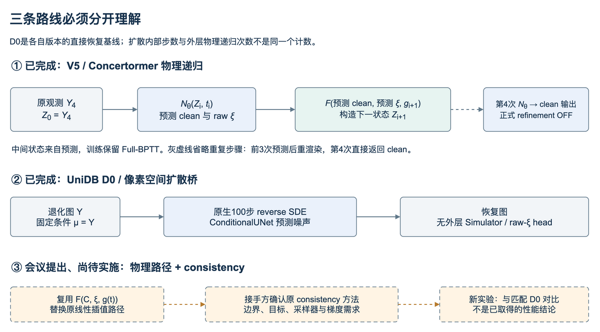

# 附录：V5递归方法与历史比较



## 1. 三种“时间/步数”不是一回事

|路线|时间变量|一次恢复做什么|物理F是否在恢复闭环里|
|---|---|---|---|
|V5 Concertormer|恢复时间t∈[0,1]，g=4(1−t)|4次网络预测；前3次后重退化生成下一状态|是|
|V6 DiffUIR-L|内部扩散时间＋外层物理时间|内部S3与外层A/B分别计数|D0无；历史物理A/B有|
|当前UniDB D0|原生τ=1…100|100步reverse SDE；Y一直作为条件μ|无|
|会议中的consistency方案|待接手方确认|拟用物理路径替代原线性插值，并改训练/采样|待实现|

D0表示该实验内的直接恢复基线，不是所有版本共用一个checkpoint。V5的observation consistency、UniDB的MatchingLoss和consistency model训练目标也不是同一种loss。

## 2. V5：先直接恢复，再单步训练，再真实递归对齐

### D0：clean-only

```text
C_hat = Dθ(Y4)
L_D0 = MAE(C_hat, C)
```

正式D0无时间条件、raw-ξ头、Simulator或refinement。官方Concertormer GoPro主体全参数微调，完成10k更新。

### A：预生成物理中间态的单步学习

```text
(C_hat, ξ_hat) = Nθ(Y_g, t),  g=4(1−t)
L_A = 0.9 MAE(C_hat,C) + 0.1 MAE(F(C_hat,ξ_hat,g), Y_g)
```

A训练输入是预生成当前强度观测，回投匹配当前Yg；不是在线四步Full-BPTT。完成6k更新，但best通过原始G4 Val1000真实四步推理选择，不能把更容易的Val-A数值放入G4主表。

### B：自身预测形成下一状态

```text
Z0 = Y4
for i = 0..3:
    (C_hat_i, ξ_hat_i) = Nθ(Zi, ti)
    Li = 0.9 MAE(C_hat_i,C) + 0.1 MAE(F(C_hat_i,ξ_hat_i,4),Y4)
    if i < 3: Zi+1 = F(C_hat_i,ξ_hat_i,g_i+1)
L_B = mean(L0,L1,L2,L3)
return C_hat_3
```

所有阶段的B回投都对最初Y4；下一状态用预测clean与预测raw，GT只作监督。保留整链梯度，不detach；正式训练/选模refinement OFF。B完成4k。D0/A/B在同一原Val1000的best PSNR为21.443506 / 20.156652 / 21.736105dB。B−D0=0.292599dB，但B第四步−第一步=−0.105346dB。[证据](../../handoff/documents/MAIN_HANDOFF_FINAL_v2.md#5-v5的三阶段正式结果)。

## 3. UniDB：当前有条件扩散，但没有外层物理递归

官方DIV2K SR `gamma_1e7.pth`初始化，固定commit见[论文/官方源](PAPERS.md)。项目`core.py`的`NativeObjective.forward`执行：

1. 给clean和degraded生成随机τ及桥状态。
2. 条件UNet以当前状态、Y、τ预测noise；通过原生公式转score。
3. 比较预测反向一步均值与使用GT计算的目标均值，`MatchingLoss(loss_type='l1')`。

这是一步均值L1匹配，不是直接回归最终100步图的clean MAE。推理`set_mu(Y)`后从Y调用100步`reverse_sde`。**没有把Y先改成随机高斯、没有VQ往返，也没有F参与100步采样。** UNet内部先计算`xt-cond`，再与cond拼接；输入条件细节见官方源码，不把它描述成单纯3通道无条件UNet。

原线保持原生目标从U45411续至U67180；另一线从官方U0使用ε_opt MSE、warmup/不同LR/clip等训练至U40848。多项因素同时改变，不是单因素loss消融。最终质量和详细诊断见[旧主报告第7节](../../handoff/documents/MAIN_HANDOFF_FINAL_v2.md#7-unidb单帧主线和午夜实验)。

## 4. 接手方要接的接口

会议（12:36–14:54、18:38–20:00）提出：把既有consistency bridge的线性插值换成由物理模型控制的路径，并适配NPU。会中“CGDB”等称呼需与接手方实际稿件和代码确认，公开同名检索不能证明就是团队版本。

推荐先把接口写清，再实现新方法：

|接口问题|现有可复用资产|新方案仍需决定|
|---|---|---|
|退化路径|`F(C,ξ,g)`与V5 `t=1−g/4`|是否保留该方向；一致性方法的时间方向可能相反|
|训练配对|160K组合、raw seed/shape/SHA与source split|相邻时间是否共享ξ；新路径状态怎样生成|
|网络|Concertormer、DiffUIR-L、UniDB像素网络|网络预测clean/noise/velocity/raw-ξ中的哪一个，怎样转换|
|目标|V5回投、UniDB原生目标可查|接手方原consistency loss、teacher/EMA/stopgrad定义|
|导数|已测C/raw-ξ一阶梯度|是否需要∂F/∂t、JVP、高阶梯度，端点如何处理|
|推理|现有D0与物理递归入口|新consistency采样器、NFE及条件是否固定|
|对照|数据、指标、初始化、best身份|匹配D0的预算/曝光/随机性与独立测试协议|

**不能只说“加一个consistency loss就好了”。** 更换轨迹后，原解析solver或目标推导是否仍成立、端点和梯度是否可用，都需重新核实。本补充不替接手方发明公式，也不把它记成已经接入。

## 5. 最小研究推进顺序

1. 跑通本补充的模拟器与UniDB示例，确认实际模块路径、输入尺度、权重和设备。
2. 接手方提供其原consistency实现，明确上述接口；用新目录实现物理路径适配。
3. 少量固定配对检查路径、端点、所需导数与完整保存/恢复，再做有界训练。
4. 同数据、同初始模型和合理匹配预算对比D0；报告第一步和末步，不只报最优一步。
5. 达到预先约定条件后才扩至全量、真实域和论文表格。已有负结果、Test锁定和原冻结目录继续保留。

这是接手后的实施顺序，不是本次已经执行的新实验。
