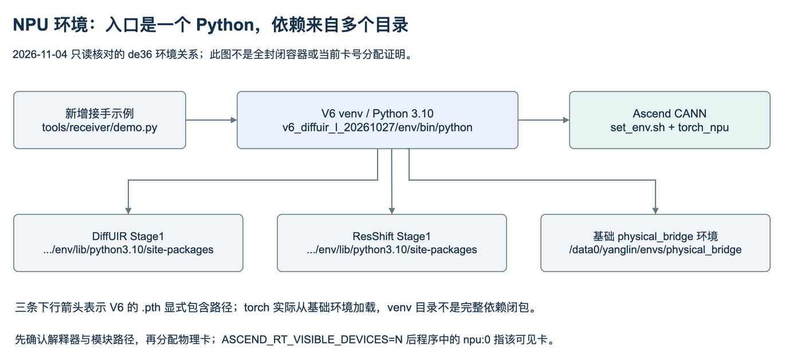

# de36：从登录到运行已有模块

本指南面向**继续使用现有de36资产**。迁到另一台机器还需要补齐vendor、数据、大权重及环境继承链，不能仅clone本仓库就完整复现。所有新输出写新目录；旧训练已结束，旧deadline/controller不是当前运行入口。

## 1. 登录、路径与账号

2026-11-04实际只读连接确认：主机`liteserver-de36`，SSH登录用户`root`；项目研究身份/目录为`yanglin`。本机SSH别名解析为`root@121.37.80.217:22`。接手者需要由项目负责人提供自己的授权登录方式；这里不包含密码、私钥或token。

```bash
# 在接手者电脑；已有相应SSH别名时
ssh liteserver-de36
# 无别名时，取得相应登录权限后使用
ssh root@121.37.80.217
```

登录后先`hostname`确认de36，再看以下入口：

|用途|绝对路径|
|---|---|
|V5 simulator|`/data2/yanglin/v5_v1_simulator_20261020`|
|V5 D0/A/B|`/data2/yanglin/v5_concertormer_10k_20261021`|
|V6与主Python环境|`/data2/yanglin/v6_diffuir_l_20261027`|
|UniDB原生模块/官方vendor/权重|`/data2/yanglin/unidb_d0_20261102`|
|UniDB中午双路线|`/data2/yanglin/unidb_dual_20261103_until_noon`|
|UniDB午夜最终结果|`/data2/yanglin/unidb_dual_20261104_until00`|
|160K train与五档val清单|`/data2/yanglin/v6_diffuir_l_20261027/execution_20261029_d0_multistrength160k/{TRAIN,VAL}_MANIFEST.jsonl`|

先取得本次完整交接ZIP，解压后将整个`turbulence-project-handoff`目录复制到服务器的新目录（例如`/data2/yanglin/receiver_handoff`）；不要只拷贝HTML。也可以直接克隆公开GitHub仓库：

```bash
git clone https://github.com/mayday4yl/turbulence-project-handoff.git /data2/yanglin/receiver_handoff
cd /data2/yanglin/receiver_handoff
# 确认取得会议补充版本：应存在 tools/receiver/demo.py
python3 tools/verify_repository.py
python3 tools/receiver/verify_supplement.py
python3 tools/receiver/demo.py inspect
```

如果仓库已存在，不重复clone；把下文`HANDOFF_REPO`改成真实clone路径。`inspect`仅用stdlib读取小型配置并核对实际依赖：模拟器vendor与canonical配置、UniDB源码清单/官方权重记录及载荷、验证manifest首个样本和各强度文件；不导入torch、不占卡。可通过`--checkpoint`和`--checkpoint-sha256`一并核对选定权重路径。本次包含U67180时检查38个不同文件，见[补强后的实测](evidence/PREFLIGHT_V2.json)。预期`status: PASS`、`errors: []`且所有路径true。

这个PASS只代表文件存在和小型元数据结构通过；不等于大文件SHA、完整数据集、Python包导入或NPU兼容性通过。模型运行时继续执行既有SHA和严格加载检查；metadata中的绝对路径不会随`--project-root`自动改写。

## 2. 环境不是一个独立conda包



|项目|已记录值|
|---|---|
|解释器|`/data2/yanglin/v6_diffuir_l_20261027/env/bin/python`|
|Python|3.10.12（本机Mac的Python不是这个）|
|torch实际来源|`/data0/yanglin/envs/physical_bridge/lib/python3.10/site-packages/torch`|
|主要包|torch 2.7.1；torch-npu 2.7.1.post2；torchvision 0.22.1；numpy 1.26.4；ema-pytorch 0.3.2|
|NPU|Ascend 910B3，驱动工具本次显示25.5.1|
|CANN入口|`/usr/local/Ascend/ascend-toolkit/set_env.sh`|

V6的`v6_readonly_dependencies.pth`包含：

```text
/data2/yanglin/v5_diffuir_l_stage1_20261026/env/lib/python3.10/site-packages
/data2/yanglin/v5_resshift_stage1_20261026/env/lib/python3.10/site-packages
/data0/yanglin/envs/physical_bridge/lib/python3.10/site-packages
```

不要删除这几个旧环境。无需在共享环境`pip install -U`。历史UniDB `run_env.sh`还设置OMP/BLAS=2、TASK_QUEUE_ENABLE=0、私有cache、`TORCH_HOME`；示例复制所需配置到新输出目录，不调用原controller。

```bash
export HANDOFF_REPO=/data2/yanglin/receiver_handoff
export HANDOFF_PY=/data2/yanglin/v6_diffuir_l_20261027/env/bin/python
export PYTHONDONTWRITEBYTECODE=1
export TORCH_DEVICE_BACKEND_AUTOLOAD=0
export OMP_NUM_THREADS=2
export OPENBLAS_NUM_THREADS=2
export MKL_NUM_THREADS=2
"$HANDOFF_PY" -c 'import sys,torch,numpy; print(sys.executable); print(torch.__version__,torch.__file__); print(numpy.__version__)'
```

`TORCH_DEVICE_BACKEND_AUTOLOAD=0`用于避免CPU检查自动导入NPU扩展；NPU示例会显式import torch_npu。示例输出目录必须不存在，这可避免覆盖旧实验。以下`run01`若用过就换`run02`。

## 3. 先跑CPU模拟器示例

```bash
"$HANDOFF_PY" "$HANDOFF_REPO/tools/receiver/demo.py" simulator \
  --device cpu --backward \
  --out /data2/yanglin/receiver_checks/simulator_cpu_run01
```

预期：`RESULT.json`、clean及g=0/.5/1/2/3/4 PNG/NPY、g4 blur-only、像素位移数组。g=0 max误差≤2e-5；g2的C/ξz/ξtilt梯度有限且非零。本次服务器实测约19.4秒，见[CPU记录](evidence/SIMULATOR_CPU.json)，实际耗时随主机变化。

这是256×256合成坡度/棋盘图，一次小规模检查；没有正式训练、数据集生成或有限差分全Gate。PNG clip到[0,1]仅用于显示；原NPY保持浮点。

## 4. 在分配到的NPU上运行

先确认实时空闲与归属；旧报告的0—7卡不代表今天仍预留。`npu-smi info`和设备PID都要看，不能只看HBM余量。本次示例避开1号外部服务；不停止任何其他任务。实际环境快照见[包与依赖来源](evidence/ENVIRONMENT_20261104.json)。

```bash
npu-smi info
# 示例：项目负责人已分配物理卡0且现场无其他占用后
fuser /dev/davinci0
source /usr/local/Ascend/ascend-toolkit/set_env.sh
"$HANDOFF_PY" "$HANDOFF_REPO/tools/receiver/demo.py" simulator \
  --device npu --physical-card 0 --confirm-card-is-allocated --backward \
  --out /data2/yanglin/receiver_checks/simulator_npu_run01
```

`--confirm-card-is-allocated`是运行者完成资源确认的显式标记，脚本不会替代调度器，也不会kill外来进程。设备被`ASCEND_RT_VISIBLE_DEVICES=0`限制后，代码内使用`npu:0`；若分配物理3，传`--physical-card 3`，代码内仍是可见设备0。

本次NPU多强度前向、g=0端点和g2的一阶反向已通过，耗时约450秒，首次运行包含算子编译等待；见[实际记录](evidence/SIMULATOR_NPU.json)。后续耗时取决于缓存与资源。

FP32、HF32关闭、JIT关闭沿用项目数值设置。UniDB在NPU还应用`0.5*x*(1+erf(x/sqrt(2)))`等价精确GELU，不能删除这个兼容修复后仍称同一已验路径。

## 5. 跑当前UniDB：严格加载，再恢复

先固定权重身份。原路线best/latest U67180的完整checkpoint：

```bash
export HANDOFF_CKPT=/data2/yanglin/unidb_dual_20261104_until00/runs/original/checkpoints/U00067180.pt
export HANDOFF_SHA=0381ae3435d2939a2b8b4fbc215c3f78ac6c3775f254bead31dee3e9cdb78e98
"$HANDOFF_PY" "$HANDOFF_REPO/tools/receiver/demo.py" unidb \
  --device cpu --action forward --weights EMA \
  --checkpoint "$HANDOFF_CKPT" --checkpoint-sha256 "$HANDOFF_SHA" \
  --out /data2/yanglin/receiver_checks/unidb_cpu_run01
```

该步骤核官方载荷和当前checkpoint SHA，严格加载EMA，然后在固定val首个样本G4做1次UNet前向。**输出noise不是恢复图**。本次CPU34.1秒通过；不把该检查的数值当正式恢复指标。

获得空闲卡后，完整100步示例为：

```bash
"$HANDOFF_PY" "$HANDOFF_REPO/tools/receiver/demo.py" unidb \
  --device npu --physical-card 0 --confirm-card-is-allocated \
  --action restore --weights EMA --g 4 \
  --checkpoint "$HANDOFF_CKPT" --checkpoint-sha256 "$HANDOFF_SHA" \
  --out /data2/yanglin/receiver_checks/unidb_restore_run01
```

本次在物理0卡、G4/EMA/U67180上实际跑完100步，约22.9秒；见[运行记录](evidence/UNIDB_NPU_RESTORE.json)。

预期`RESULT.json`的nfe=100，另有input/clean/prediction的原float数组与显示PNG。示例B1随机流不同于正式每source四实现的B4评价，不保证逐像素复现原表；要复算正式指标必须使用原`validation.py`的组seed、人口、RAW/EMA、100步SDE、原float RGB/no clip/crop/resize协议。该模块依赖HCCL，不适合直接以普通单进程调用。

省略`--checkpoint`会明确使用官方SR初始化，而不是自动找latest。完整项目checkpoint含NumPy RNG等对象；脚本只在明确给定且SHA匹配后以`weights_only=False`读取，不能用于来源不明的模型。

其他最终角色见[权重登记](../../handoff/registers/WEIGHT_REGISTER.csv)：改进latest U40848、改进best U10000；RAW键为`network`，EMA键为`ema.network`。恢复图展示用EMA不等于完整续训。

## 6. 继续训练时从哪里接

**现有历史worker是可读的完整训练实现，但不是今天可以原命令直接重启的通用训练器。** 它绑定2026-11-04截止、原root、固定卡数、源SHA与旧STOP。只删除STOP或改一个日期会破坏身份/恢复约束。

|需要做什么|从哪里开始|关键事项|
|---|---|---|
|复用模拟器接新consistency|`simulator_v5.py`＋接手方原consistency代码|先确认t方向、ξ共享、所需JVP/时间导数，见方法说明|
|看V5 A/B训练|`alignment_training/runner.py:main/train`、`factories.py`、`training/core.py`|A/B目标与配置不同；恢复完整optimizer/scheduler/sampler/RNG|
|看UniDB原生目标|`unidb_d0_20261102/core.py:NativeObjective`|同官方网络/桥/MatchingLoss，不引入新的clean loss|
|继续午夜双路线|`unidb_dual_20261104_until00/training_worker.py`及controller|原线3物理卡承载8逻辑RNG，改线5物理卡；B96；新root/新截止/新冻结清单|
|复现原完整评价|同分支`validation.py:evaluate`|保持B4/source、derive seed、EMA digest和人口，另写新输出|

准备一个新run时逐项执行：

1. 选定目标：复现、续训或实现新consistency；给新目录与预算，保留原目录只读。
2. 从选定完整状态加载`network / optimizer / ema / RNG / loader_generator / cursor / counts / scheduler`，明确是否改变world size或数据顺序。只加载EMA是新初始化，不叫无缝resume。
3. 在新副本里集中更新`ROOT`、资源、截止、source/authority manifest及检查器，不改原冻结源码。先核对本来使用哪个完整父状态。
4. 按新卡数完成一次真实更新→完整保存→重启一致性检查；临时更新不计正式结果。
5. 冻结新配置后，用该副本worker的真实CLI启动。历史接口形式如下，**不是未经适配即可粘贴运行的命令**：

```text
python -m torch.distributed.run --nproc_per_node=<3或5> --master_port=<空闲端口>
  <新副本>/training_worker.py --branch <original或improved> --phase formal
  --out <新root下的run目录> --resume <已核验完整checkpoint> --monitor-every 1000
```

会议新增consistency尚无完整可执行入口，必须由接手者接入其原实现；本次不给一个实际上不存在的“consistency_train.py”命令。

## 7. 常见故障

|现象|先查哪里|
|---|---|
|找不到torch/ema_pytorch/einops|打印sys.executable、模块__file__及三层.pth；是否误用了系统Python|
|找不到`vendor.unidb_gou`|原UniDB目录/vendor是否在；Git源码快照故意不包含完整官方vendor|
|canonical mismatch|是否换了参数/图尺寸或重建了buffer；不要覆盖原参考来消掉错误|
|SHA不匹配|确认具体分支/权重角色/源文件；不要跳过assert|
|旧worker立即停/authority拒绝|旧截止、STOP、root与源清单绑定；创建新run并完整适配|
|NPU数值与CPU不同|精确GELU、FP32/HF32、同一输入/噪声、canonical buffer；不能仅保证同seed|
|ACL 500001 / cache路径报错|确认私有`ascend_cache`目录已创建且可写；本次首轮因此失败，修复demo后重跑通过，保留原失败日志|
|首次运行长时间出现编译等待|查看本任务PID、输出文件时间和编译进程；本次模拟器含反向约7.5分钟，不能据此认定模型在训练|
|示例目录已存在|换新目录；该保护防止混合两次结果|
|OOM|先查活进程、batch与100基卷积缓存；别终止他人任务，别以AMP悄悄改变正式协议|

本次实际检查范围与未执行项见[验收记录](VALIDATION.md)。
