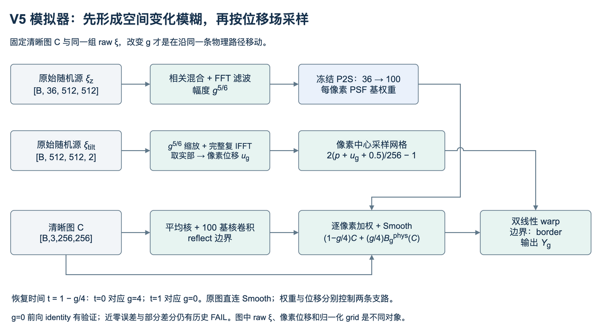

# 模拟器：从两块随机源到一张湍流图

本说明针对**V5实际使用的Smooth＋pixel-center warp＋legacy full IFFT路径**。旧v1/V4与V5不能混用。公式来自项目源码；P2S论文解释基础思想，本项目的Smooth、时间接口与历史兼容选择不是原论文的全部原样实现。



## 1. 它做什么

用 <i>Y</i><sub>g</sub> = <i>F</i>(<i>C</i>, ξ, <i>g</i>) 表示退化：给定清晰RGB图C、固定随机实现ξ及强度g，先形成空间变化模糊，再按位移场采样，得到 <i>Y</i><sub>g</sub>。这个F不预测clean，不负责反向扩散，也没有optimizer。

图中的数学符号与代码名称对应如下；公式使用上下标，代码标识与文件名保持原字符，方便查找和复制。

|图中符号|含义|代码对应|
|---|---|---|
|ξ<sub>z</sub>|Zernike支路的原始随机源|`Realization.epsilon_zernike`|
|ξ<sub>tilt</sub>|位移支路的原始随机源|`Realization.epsilon_tilt`|
|<i>u</i><sub>g</sub>|强度g下的像素位移|`effective_state.displacement`|
|<i>B</i><sub>g</sub><sup>phys</sup>(<i>C</i>)|Smooth混合前的物理模糊图|`render_prepared()`内的`physical_blur`|
|<i>Y</i><sub>g</sub>|完整退化图|`RenderResult.output`|
|<i>g</i><sup>5/6</sup>|两条随机支路使用的幅度因子|`self._strength_tensor(g, b).pow(5 / 6)`|

历史递归方法附录图中的 <i>N</i><sub>θ</sub> 是恢复网络，<i>Z</i><sub>i</sub>、<i>t</i><sub>i</sub> 是第i次输入状态与时间；<i>Z</i><sub>i+1</sub> 是预测后重渲染得到的下一状态。

两类随机源共同描述一次湍流实现：

|对象|实际形状|含义|
|---|---|---|
|C|`[B,3,256,256]`|FP32 RGB图；训练中的预测clean也能输入|
|`epsilon_zernike`|`[B,36,512,512]`|36通道独立标准高斯原始随机源，**不是最终Zernike系数场**|
|`epsilon_tilt`|`[B,512,512,2]`|两通道独立实高斯原始随机源；末轴是x/y分量，**不是复数实部/虚部**|
|g|标量或`[B]`，范围`[0,4]`|退化强度；这里不是扩散的100步时间索引|
|Zernike场|`[B,36,256,256]`|经过相关性与频域滤波后的相位系数|
|displacement|`[B,256,256,2]`|以像素为单位的位移场|
|`RenderResult.flow`|`[B,256,256,2]`|归一化grid_sample采样坐标，**不是像素位移**|

`sample_realization()`在CPU固定随机种子生成两块raw，再转设备。跨ARM/x86同seed未必逐位相同，复现正式数据还需原seed/shape/raw SHA及canonical buffers，不能只记一个seed。

## 2. 模糊支路：raw → Zernike → PSF权重

`effective_state()`先使用幅度`a(g)=g^(5/6)`。记R为固定Zernike通道相关矩阵、S为固定空间谱滤波器：

```text
mixed = R × [g^(5/6) · epsilon_zernike]
z_g   = real(IFFT2(S · FFT2(mixed)))，再裁到256×256
w_g(p) = P2S(z_g(p)) ∈ R^100
```

其中36→100的P2S小网络被冻结，把每个位置的相位表示变成100个空间PSF基的系数。它不是137M参数的UniDB，也不是待训练的恢复网络。

令μ为33×33平均核、b_k为100个33×33基核，物理模糊可写为：

```text
Bphys_g(C)(p) = (μ * C)(p) + Σ[k=1..100] w_g,k(p) · (b_k * C)(p)
```

`prepare_image(C)`预先算出平均核与100基核卷积；空间变化体现在每个像素的w不同。卷积先做16像素reflect padding，同一个像素的权重共享给RGB三个通道。P2S基展开没有额外softmax/强制非负或重新归一化，浮点结果可能轻微越过[0,1]。

**V5新增Smooth：**

```text
α = g/4
Bg(C) = (1-α) · C + α · Bphys_g(C)
```

这是warp之前的identity/物理模糊混合，等价于`h̃g=(1-g/4)δ+(g/4)hg`。注意hg本身也随g改变，不能把整条路径理解成固定Y4与C的线性混合。

## 3. 位移支路：raw → 空间位移 → 采样网格

V5默认`tilt_fft="legacy_full"`：同一个完整复频域滤波器H分别作用于两块实随机源，沿两个空间轴做完整复IFFT，最后取实部。

```text
u_g = tilt_constant · real(IFFT2(H · g^(5/6) · epsilon_tilt))
grid_g(p) = 2 · (p + u_g(p) + 0.5) / 256 - 1
Y_g = grid_sample(Bg(C), grid_g,
                  mode="bilinear", padding_mode="border", align_corners=False)
```

`pixel_position`最后一维是[x,y]。`+0.5`把像素中心映射到`align_corners=False`的坐标约定。这里是**逆向采样**：输出位置p从输入位置p+u取值，不应把箭头画成前向散射。边界外取border；先blur后warp，不可随意互换。

旧`v4_irfft`分支只是诊断对照，正式V5不使用它。当前legacy路径的非平稳协方差仍是已登记局限；“与历史API等价”不等于物理统计完全正确。

## 4. 时间如何控制物理路径

V5恢复时间`t=1-g/4`，所以恢复方向是：

|t|0|0.25|0.5|0.75|1|
|---|---:|---:|---:|---:|---:|
|g|4|3|2|1|0|
|含义|强退化|较强|中等|较弱|clean端点|

固定C和同一ξ，改变g才是在追踪同一条物理轨迹；每步重新抽ξ会同时改变随机实现。V5训练抽三个严格内部时间并排序，推理默认整数强度。最终g=0是物理端点，不是第五次网络调用。

**g=0的前向：**g^(5/6)=0使位移为0，Smooth使blur回到C，pixel-center grid使warp为identity。已有端点与图像Jacobian检查支持这一配置。**这不保证近零g处任意图像误差都低于固定阈值，也不保证关于g的导数可用**；g^(5/6)在0处的导数问题需要新方案单独处理。

## 5. 可微不等于无条件验收通过

物理资产参数被`requires_grad_(False)`冻结，但输入C和ξ仍能经卷积、P2S、FFT和grid_sample反传。V5 B通过预测clean/ξ生成下一状态，保留Full-BPTT；不能在这条训练路径包`no_grad()`或`detach()`。

已知限制：原Gate的近零边缘绝对误差、部分局部/全图有限差分没有全部通过；后来是在保留这些记录的前提下研究接收。ReLU与双线性插值是分段可微，差分步长跨折点或过小受FP32舍入影响。新增接手示例只检查一个合成点的有限一阶梯度，不能覆盖原FAIL。

依据：[原Gate](evidence/ORIGINAL_SIMULATOR_GATE_ZH.md)；[研究接收决定](../../handoff/evidence/v5_v1_simulator_20261020/acceptance_20261021/RESEARCH_ACCEPTANCE_ZH.md)。若某原件不在便携包，按[代码导航](CODE_MAP.md)的原位置读取。

## 6. 最小调用

先配置路径与环境，见[NPU指南](NPU_RUNBOOK.md)。代码核心是：

```python
from simulator_v5 import build_simulator
sim = build_simulator(device="cpu")  # 原256/512与canonical物理参数
raw = sim.sample_realization(1, seed_zernike=843001, seed_tilt=843002)
result = sim.render(clean_rgb, raw, 2.0)
degraded = result.output
blur_only = result.blur_only
displacement_pixels = result.effective_state.displacement
normalized_grid = result.flow
```

用`build_simulator`而非仅实例化`V5Simulator`，前者会绑定原生成侧的canonical buffer。需要同时保留：`P2S_model.pt`、`dictionary.pt`、`I0_I2.pt`、`CANONICAL_CPU_REFERENCE.json/.npz`，以及对应源码。不同物理参数/分辨率不能强行复用这份canonical参考。

[可直接执行的独立示例](../../tools/receiver/demo.py)生成合成RGB图的g=0/.5/1/2/3/4、g4 blur-only与像素位移，并可检查g2处C/raw-ξ梯度。展示PNG会clip，计算和NPY不clip；这些图只讲机制，不是新增恢复实验。
