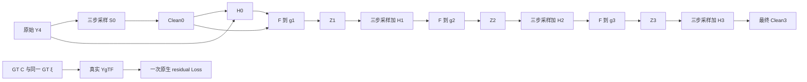

# V6 方法理解与现有代码审查

日期：2026-10-27。方法依据为完整阅读的 `V6-method-v1.0`（440 行），原件 SHA256 `4c0672c761fe93d36e4a7f17953a5e2d61689d99199a28b2e68d607a38d0cbda`。原件不修改，逐字节副本位于本目录 reference。

**结论：V6 的主要方法已能映射到已验收 DiffUIR 与旧 V5 的物理资产，但 V6 联合训练图尚不存在。D0 不是旧原生 Pilot 的续训；A 的物理时间 Adapter 和独立 ξ Head 是新增模块；B 必须重新连接四次三步采样、ξ 预测、三次物理转移及真实配对 TF 分支。单项反传通过不等于 V6 Full-BPTT 通过。**

本报告是方法理解与静态代码审查交付，不声称运行过 V6 模型、优化器或新数据生成。审查期间用户另行提供 Training Handoff、正式执行授权、A best 选择补充及自动执行补丁；这些已进入后续执行范围，本报告仍单独保留，不把后续工作冒充本次审查的实测证据。

## 1. 审查证据与新旧方法边界

已读项目索引、完整方法规范、Stage1 最终报告和科学代码、Batch worker、旧 V5 Clean-only D0 / alignment A/B、Simulator、原数据及缓存接口。固定官方 commit 为 `c71437ce86ad1b098aa9be4678dc82e8b99649df`，本地 tracked 状态干净。34 个选定科学源码/结果文件与 de36 部署副本 SHA 全部一致（00:40 北京时间）；远端没有 `.git`，首次 Git 元信息检查失败已保留，第二次按文件内容核对成功。未将此扩大为全部远端文件或当前设备空闲证明。

| 对象 | 旧 V5 / 已有 DiffUIR 检查 | V6 定义 |
|---|---|---|
| Clean 恢复 | Concertormer 一次 RGB 残差回归；DiffUIR Stage1 仅单项测试 | DiffUIR-L 像素条件残差扩散，真实三步生成 Clean |
| 初始化 | V5 用 Concertormer GoPro；DiffUIR 短 Pilot 用 raw | D0 从官方 DiffUIR EMA **网络参数**开始；A 从 D0 best；训练协议规定 B 从 A best EMA |
| D0 目标 | 旧 V5 Clean MAE；旧 DiffUIR Pilot 原生 residual L1 | RGB 单位的 residual L1 + 实际三步 Clean L1 |
| A 的 ξ | 旧共享 Concertormer 特征直接输出 raw | 独立 U-Net 读取当前观测、当前三步 Clean 和物理时间 |
| 时间 | 旧 V5 只有物理时间 | 保留扩散时间，同时增加独立物理时间 Adapter |
| B | 4 次直接恢复、3 次物理转移 | 4×3 次 denoiser、同样3次物理转移；增加1次真实 TF residual 调用 |
| 新噪声 | 旧 V5 外层不加 RGB mixing noise | 每次内部采样有独立初始噪声；仍无外层 mixing noise |

这不是“只换一个 U-Net”，也不是更换 VQ：V6 使用完整的 DiffUIR Clean 恢复功能，但继续使用旧 V5 的外层物理问题与 Simulator。ResShift / VQ 不进入 V6。

规范 §1 的旧 B `21.7334 dB` 是较早记录。当前最终 `FINAL_RESULTS.json` 为 B U2750 `21.7361049 dB`，同模型四步为 `21.8414507 → 21.7930817 → 21.7639680 → 21.7361049`。因此最终 B 比其 Step1 低 `0.1053458 dB`；这不改变规范的科学结论，也不修改规范原件。旧 D0 U8250 `21.4435057`、A U5000四步 `20.1566522`。这些均不是 V6 结果。

## 2. 两种时间与三种随机性

物理时间 `t=1-g/4` 描述当前湍流强度：起点 `t=0,g=4`，终点 `t=1,g=0`。扩散索引 `τ∈{0,…,999}` 描述 DiffUIR 内部状态，网络实际收到的是 `a_τ×1000`，不是直接把 τ 或物理 t 互换。

真实数据中的 `ξGT` 决定一个物理 realization；同一 trajectory 的所有 g 都复用它。原生 residual 训练独立抽 `τ, εq`。三步采样另抽 `εs`，B 四个阶段分别抽 `εs,0…εs,3`，互相独立且不与 εq 复用。

对真实配对 `(X,C)`，归一化 `X′=2X−1,C′=2C−1,R′=X′−C′`：

`xτ = C′ + aτR′ + bτεq − dτX′`。

网络输入 `concat(xτ,X′)` 为 `[B,6,256,256]`，输出三通道 residual。Condition 还参与 q_sample、采样初始状态和逆更新；不能只保留拼接而忽略其他位置。没有 text/task embedding，接口中的 `blur` 字符串不是物理条件。

三步采样仅从当前观测出发：`x999=(1−d999)X′+0.1εs`；网络调用索引为 `999→665→332`。前两次按原生系数更新，末次输出 `unnormalize(clamp(X′−clamp(pred_res)))`。保留两层 clamp 的真实梯度。`eta=0` 只取消采样中途随机注入，初始随机性仍在。返回列表含初始图和三次更新，共4个元素，Clean 必须取 `[-1]`；NFE仍为3。

## 3. D0/A/B 的接口与 Loss

下面是应实现的数学接口，不是已存在的 V6 API：

- `residual_loss(X,C,t_phys,tau,eps_q)`：只能接真实配对，返回 RGB 单位 residual MAE；D0没有物理 Adapter。
- `sample_clean(X,t_phys,eps_s)`：不接受 GT，完整执行三步，返回 `[B,3,256,256]` Clean。
- `predict_raw(X,clean_hat,t_phys)`：仅 A/B；返回含 native raw 两字段的对象；Clean 不 detach。
- `render(clean_hat,raw_hat,g)`：冻结物理参数，保留对 Clean 和 raw 的输入梯度。

令 `Lofficial=MAE(pred_res,R′)`。官方 `p_losses(...)[0]` 返回它，而 V6 定义 `Lres=0.5×Lofficial`。因此实际拼合应为：

| 阶段 | 实际 Loss（按官方函数返回值展开） | denoiser forward/样本 |
|---|---|---:|
| D0 | `0.5 Lofficial + 1.0 MAE(S3(Y4),C)` | 4 |
| A | `0.5 Lofficial + 0.9 MAE(Ĉ,C) + 0.1 MAE(F(Ĉ,ξ̂,g),Yg)` | 4 |
| B | `0.9 mean4 MAE(Ĉi,C) + 0.1 mean4 MAE(F(Ĉi,ξ̂i,4),Y4) + 0.05 Lofficial_TF` | 13 |

`0.5` 是单位换算，不能漏乘，也不能把它和外部 Loss 系数重复应用。独立 Clean Loss 来自真实采样，不能由 GT-conditioned q_state 上的单次 residual 输出构造一个等价 Clean Loss 来代替。

D0 只有 DiffUIR 主干，无 Adapter/ξ/Simulator。两个分支在同一次更新前使用同一份当前训练参数；累计完梯度才做一次 optimizer step。官方 EMA 是初始化来源，不意味着训练 residual 用 raw、采样 Clean 用另一套 EMA 参数。

A 使用 `25% g=4 + 75% U(0,4)` 的真实 `Yg=F(C,ξGT,g)`，单次采样恢复后预测 ξ。物理目标是本次 `Yg`，不是原始 Y4；不另加 G4 物理项，不对 ξGT 做监督。A 的三个系数从首步固定，不能解释为梯度贡献百分比。

B 每条 rollout 抽三个 iid Uniform 内部物理时间并排序；训练路径100%随机。固定验证路径为 `[0,.25,.5,.75,1]`，只有前四个节点调用恢复网络。后续网络仅读自己的 `Zi,ti`，原始 Y4 只进入物理 Loss 锚点。

## 4. A/B 的新增网络

Physical-Time Adapter 为 `p=SinEmbed64(1000t)`、`ephys=t×W2(SiLU(W1(p)))`，维度64→256→256；W2权重与bias零初始化。将 `ephys` 加到官方 `unet0.time_mlp` 的256维扩散时间特征上，传给原 ResnetBlock 的 scale/shift。官方扩散 MLP 内部使用 GELU，保持它；新增物理分支使用规范中的 SiLU。不增加第7个图像通道。

初始化时对任意 t，新增增量为0；对任意后续参数状态，t=0的物理增量仍为0。后者只表示相同当前主干下移除 Adapter 不改变结果，不保证主干训练后还等于最初的 D0 checkpoint。第一步 W1 零梯度是零初始化的预期，不能沿用旧 benchmark 的“所有参数首步都必须非零”断言；要在 t>0 测 W2，再测后续 W1。全 t=0 批次无法检验 Adapter 可训练性。

ξ Head 接受 `concat(X′,Ĉ′)` 六通道，编码32/64/128/256，解码32×256²，经 Conv32→128、PixelShuffle2变成32×512²，再两残差块及线性38通道输出。前36通道对应 `[B,36,512,512]` raw Zernike；后2通道 permute 为 `[B,512,512,2]` raw tilt。该最后维是 dx/dy，不是复数实虚部分。不得自行缩放、压缩为 latent、clamp 或做相关性变换。

现有旧 `raw_head` 直接读取48通道 Concertormer特征，不能直接替用；它的 RawXi 字段/layout可以作为接口参考。**规范尚未完整定义 ξ 分支时间调制的具体算式与各尺度投影方式**，详见问题表。这项不能从旧 V5 的 FiLM 草案隐式继承。

## 5. B 的完整计算图

图中四次恢复共用一套 θ/φ/ψ；各阶段内部的3个denoiser也共用θ/φ。每次预测的 Clean/ξ 另在 G4 重建原始 Y4，四项物理 Loss 等权平均；图为简洁省略这四条旁支。三次转移与四次物理监督共7次可微 F 调用，另有真实 TF 数据合成。最终直接返回 Clean3，不多算一次 g=0渲染或第5次恢复；ξ3仍由第4项物理监督训练。

TF 每条 rollout 独立等概率抽 `J∈{0,1,2,3}`，取本条路径的 `tJ`；使用同一 GT source/realization 真实合成观测。TF只有一次residual调用，无额外三步采样，不能把预测的Zi冒充真实Yg。排序后三个内部点的边缘密度分别为 `3(1−t)²,6t(1−t),3t²`，三者均匀混合恰为1；加上 J=0 的1/4质量，得到与A相同的边缘分布。TF与外层路径相关，不代表真实与预测状态分布相同。

Full-BPTT 要求后面的 Loss 穿过前面的 `S3→Ĉ→H/F→Z`。物理项对 Clean 有直接 `F_C` 路径，也有经 H 的 `F_ξ H_C` 路径。冻结 Simulator 参数不能把整个 Simulator 调用放进 no_grad；GT真实状态合成无可训练输入，可与预测图隔离。

必须用**只有最终 Clean3 L1** 的隔离 backward 检查 Ĉ0..2、ξ0..2、Z1..3，以及各内部采样调用，不能用平均四步 Loss 掩盖断链。此隔离测试不应要求 ξ3 有梯度：ξ3不决定Clean3；它应在单独第4项物理 Loss 测试中得到梯度。raw存在物理零空间，不要求每个元素都非零；要在有信息的测试样例上检验有限、非零聚合梯度及正确VJP。

## 6. 可复用与未完成边界

可复用的是固定官方代码/EMA权重、精确权重检查、原生训练/采样公式、仅打开两个no_grad装饰器的验收方法、同噪声对照与梯度观察器；以及旧 source/trajectory身份、原生ξ重放、Simulator资产、严格物理时间采样、A/B物理锚定逻辑、图像指标与原子checkpoint思想。

不能直接搬用：raw-only Pilot入口；绑定推理init的EMA加载器；按每图重置相同seed的旧Val4 evaluator；旧ξHead与物理时间FiLM；固定B48/6000更新的旧A采样器；不返回GT realization的旧训练dataset；旧B缺失TF的runner。旧A是10分层真实时间缓存，不等于可替代V6任意连续g，更不能用最近缓存节点替代本条B路径的TF时间。

尚未验收：V6 EMA参数初始化与独立schedule、D0合图、Adapter、ξHead、A物理双路梯度、B13次denoiser全链及TF、固定样本×阶段随机流、V6完整图显存/吞吐、DDP/EMA/resume、正式完整Val1000。历史native16和sampling8仅是单项证据；先前22.55图/秒或六卡10小时约487万呈现的外推不适用于V6联合Loss。

Simulator保留原已登记局限：部分原近零/差分Gate未过，研究接收没有改写FAIL；非平稳协方差、raw冗余/零梯度方向、负PSF和少量越界仍在。当前新ξHead输出分布下的稳定性必须重新检查。不能因物理Loss降低就声称识别出唯一真实ξ。

## 7. 本次交付与后续授权衔接

- [Spec-to-code映射](</Users/lucas/Desktop/turbulence IR/v6_diffuir_l_method_review_20261027/SPEC_TO_CODE_MAPPING_ZH.md>)：逐模块入口、行号、复用边界。
- [问题与最小验收清单](</Users/lucas/Desktop/turbulence IR/v6_diffuir_l_method_review_20261027/OPEN_ISSUES_AND_ACCEPTANCE_ZH.md>)：区分方法缺项、工程验证与训练协议事项。
- `evidence/LOCAL_SOURCE_SNAPSHOT.json`、`REMOTE_SOURCE_VERIFICATION_02.json`：34项本地/远端内容身份；首次失败记录另存。

用户后续执行补丁已取消所有基于PSNR/恢复收益的阶段阻塞；负结果正常记录，不改方法/学习率/预算。A best依据固定Val1000固定四步最终PSNR，G4单次与TF仅辅助。数据、权重、计算图、梯度、资源和checkpoint仍为硬门槛。本审查完成后进入独立V6执行目录，绝不覆盖历史实验。
